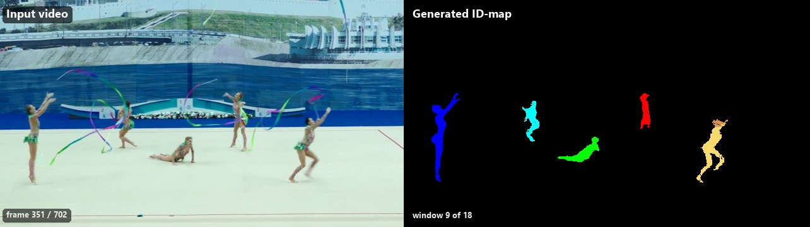

# The Generator Is the Tracker

Multi-object tracking by painting persistent identity colours with a video generator.

**[Project page with videos](https://sonam525.github.io/Generator-as-the-tracker/)** ·
**[Paper](https://arxiv.org/abs/2607.17120)** ·
**[LoRA checkpoints](https://huggingface.co/Sonam5/Generator-as-the-tracker)**



A pretrained 22B text-to-video diffusion model (LTX-2.3) is fine-tuned with a lightweight
in-context LoRA to translate an RGB clip into an **ID-map** clip: every person is painted a
flat, distinct colour that stays the same over time. Long videos are generated as chained
49-frame windows, each conditioned on the cleaned tail of the previous one, and a short
*continuation* fine-tune teaches the model to extend a colouring it is handed. Tracks are read
off the generated video by nearest-palette colour quantisation. There is no separately trained
detector, no motion model, and no association module: identity state lives in the pixels.

> Paper: [arXiv:2607.17120](https://arxiv.org/abs/2607.17120). The numbers below follow the
> November 2026 revision (`paper/iclr2027/`, and `paper/arxiv/` for arXiv v2); arXiv v1
> (July 2026) predates it.

## Headline results (DanceTrack)

| Setting | HOTA | DetA | AssA | IDF1 | MOTA |
|---|---|---|---|---|---|
| **Test server**, single frozen submission (35 videos) | **40.3** | 37.6 | **44.1** | 45.2 | 16.2 |
| Validation, chained generation (25 full videos) | 34.8 | 32.3 | 38.3 | 38.3 | 7.6 |
| Validation, chain windows re-linked post hoc (control) | 34.7 | 32.5 | 38.0 | 37.7 | 9.0 |
| Validation, same boxes, Kalman/IoU association | 25.9 | 32.7 | 21.6 | 25.1 | 7.1 |
| Validation, same boxes, DINOv3 appearance + motion bank | 27.5 | 32.5 | 24.3 | 27.6 | 7.3 |
| Validation, independent windows + post-hoc association | 18.2 | 19.7 | 17.7 | 17.3 | -13.3 |

Absolute HOTA sits with 2020-21 detector-based trackers (2025-26 specialists reach 66-76),
but the error profile is inverted: association exceeds every entry of the 2020-22 benchmark
suite while detection is the deficit, and on identical boxes the generated colours beat
classical association by 14-17 AssA. On 383 mined occlusion events the chain re-acquires
42% of the identities it held on both sides of the gap, by keeping the colour alive in
pixels through the occlusion.

Every number above comes from a logged run.

## Second benchmark (SportsMOT, validation only)

The same recipe re-run from the stock backbone with a fresh LoRA, nothing re-tuned: SAM 3
silhouette labels on the train split, the DanceTrack rank, learning rate and step budget,
checkpoints selected by the same foreground-IoU rule on a fixed 8-video subset.

| Setting (45 validation videos) | HOTA | DetA | AssA | IDF1 |
|---|---|---|---|---|
| Chained generation, colour as identity | **26.9** | 26.0 | **28.2** | 31.9 |
| Same boxes, Kalman/IoU association | 20.9 | 26.2 | 17.1 | 22.3 |
| Same boxes, DINOv3 appearance + motion bank | 23.0 | 26.1 | 20.7 | 25.9 |
| Zero-shot DanceTrack checkpoint (8 selection videos) | 17.0 | 14.0 | 20.8 | 17.8 |

The ordering on identical boxes replicates and the held-out 37-video mean (26.9) matches the
selection subset. Long-gap re-acquisition does not transfer: 369 of the 374 SportsMOT gap
events are players leaving the frame rather than occlusions, and a player who is off-frame
cannot be kept alive in pixels. Inside the 49-frame context the colours still re-bind 15 of
53 held events (chance 0.10); beyond it they are at chance.

## Repository layout

```
core/                shared library used by every area
  gentrack/          colour codec and palette (frozen), data plumbing, pipeline, model
                     adapters, identity bank, evaluation
  tests/             pytest suite (codec round-trip invariant first)
datasets/            download and labelling scripts for DanceTrack, SportsMOT, MOT17; data.yaml
image_generators/    earlier trials with image generators (Gemini image API, Cosmos3-Nano)
                     and their findings
video_generator/     the method in the paper: LTX-2.3 IC-LoRA training, chained generation,
                     evaluation, baselines; configs/, ablations/, submission/
paper/
  iclr2027/          the ICLR 2027 version (anonymous)
  arxiv/             the arXiv version (authors shown), derived from iclr2027/
  figures/, tables/, references.bib    shared by both versions
  scripts/           build every table and figure; derive and pack the arXiv version
  data/, assets/     run records and figure inputs the scripts read
experiments/         job records: the parameters of the paper's Databricks runs
docs/                project website (index.html, media/, make_page_media.py); PATH_MAP.md
                     (old and new paths); VOLUME_README.md (what is on the data volume)
```

Hidden folders, all git-ignored: `.cache/` holds the pytest and ruff caches and, like Python's
`__pycache__/` folders, is safe to delete.

## Reproducing

Compute runs on a Databricks workspace with one A100 80GB; datasets, checkpoints and
outputs live on a mounted volume. Notebooks read two environment variables, set on the
cluster: `GENTRACK_WS`, the workspace folder that holds this repository (for example
`/Workspace/Users/<you>/gentrack`), and `GENTRACK_VOL`, the volume root (default: the path
used for the paper runs). `GENTRACK_VOL` does not reach the YAML files: the trainer configs
in `video_generator/configs/`, `datasets/data.yaml` and `image_generators/cosmos/train.yaml`
keep the original absolute path, so on another volume replace the root in those files too.

```bash
pip install -e ".[dev]"
pytest -x                          # core/tests; codec invariant must be green before anything else
python -m ruff check core/         # lint
```

Then, as Databricks notebooks in order: `datasets/download_dancetrack` and
`video_generator/download_ltx_native` (data and LTX-2.3 weights to the volume),
`datasets/sam3_pseudo_masks` (silhouette labels, train split only), and from
`video_generator/`: `ltx_make_dataset` (once for the training pairs, once for the in-loop
validation clips; the widget defaults render a 12-clip demo set), `ltx_train` via `ltx_run`
with `configs/ltx_v2v_ic_lora_phase2.yaml` then `phase3.yaml` (`ltx_run` runs the trainer's
latent preprocessing on first use), `ltx_render_windows` (`vids=all_val`) and
`ltx_run_chain` (mode `chain` for the generator-carried arm, `independent` for the post-hoc
arm; a `seed` widget for seed-variance runs), `ltx_arm_eval`, `ltx_reacq_study`,
`ltx_assoc_baselines`; for the test server, `download_dancetrack` with the test archives,
`ltx_render_test`, `ltx_run_chain` with `out_name=ltx_test_chain`, then `ltx_test_submit`.
Widget values used for the logged runs are in `experiments/jobs/paper_runs/`. Hyperparameters, prompts,
decode rules and the TrackEval invocation are listed in Appendix A of the paper; training
settings are in `video_generator/configs/`, decode and evaluation parameters at the top of
each evaluation script. `video_generator/README.md` describes every script.

Paper tables and figures are rebuilt from the run records with

```bash
python paper/scripts/make_tables.py            # per-video, sub-metric and re-acquisition tables
python paper/scripts/make_revision_tables.py   # needs Databricks CLI access to the volume: pulls results/ltx_revision_*, builds the chain-length figure
python paper/scripts/make_figures.py           # all figures
```

## Working agreement

The rules every run followed; code comments cite them by number.

1. **Codec first.** Nothing proceeds until the codec round trip
   (`core/tests/test_color_codec.py`) is green: mask IoU ≥ 0.99 and every identity preserved.
   When a metric looks wrong, suspect decoding before the model.
2. **ID-maps are lossless.** PNG or FFV1 only; lossy compression smears flat colours and
   silently corrupts decoding. The codec refuses lossy formats.
3. **Ladder order with gates.** Phases run in order, and no later phase runs while an earlier
   gate fails. Gates are measurements, not targets.
4. **Decode, correct, re-encode.** Every chained run conditions on the cleaned map, never on
   raw generated output.
5. **Validation hygiene.** Validation videos never enter training in any form.
6. **Spending.** Paid API calls are estimated before every batch and capped; cost is logged
   per run.
7. **Test servers at the end only.** Development uses local validation; the test server got
   one frozen submission.

Parameters are pinned in the experiment log before each run, never tuned in response to a
result; any later change starts a new, labelled run. Gated model licences, spending above
the cap and gate decisions were always left to a person.

## Data and licences

The code is released under the MIT licence (`LICENSE`).

DanceTrack and SportsMOT are used under their non-commercial research licences. Released ID-map outputs and
LoRA weights are for non-commercial research only; the LoRA is a derivative of LTX-2.3 and is
distributed under the LTX-2 Community License Agreement. The four LoRA checkpoints used in the
paper (DanceTrack and SportsMOT, translation and continuation phases) are on
[Hugging Face](https://huggingface.co/Sonam5/Generator-as-the-tracker), with SHA-256 checksums. The project-page videos
(`docs/media/`: the full validation video dancetrack0065 and a 107-frame excerpt of
dancetrack0019) and the frames in the paper's figures (`paper/assets/`) are shown for reference
and credited to the DanceTrack authors; this repository does not redistribute either dataset.

## Citation

```bibtex
@article{yang2026generator,
  title   = {The generator is the tracker: Multi-object tracking by painting persistent
             identity colours},
  author  = {Yang, Haiyu and Hostens, Miel},
  journal = {arXiv preprint arXiv:2607.17120},
  year    = {2026},
  doi     = {10.48550/arXiv.2607.17120}
}
```

Please also cite the datasets and models this work builds on:

```bibtex
@inproceedings{sun2022dancetrack,
  title     = {{DanceTrack}: Multi-object tracking in uniform appearance and diverse motion},
  author    = {Sun, Peize and Cao, Jinkun and Jiang, Yi and Yuan, Zehuan and Bai, Song and
               Kitani, Kris and Luo, Ping},
  booktitle = {IEEE/CVF Conference on Computer Vision and Pattern Recognition (CVPR)},
  year      = {2022}
}
@inproceedings{cui2023sportsmot,
  title     = {{SportsMOT}: A large multi-object tracking dataset in multiple sports scenes},
  author    = {Cui, Yutao and Zeng, Chenkai and Zhao, Xiaoyu and Yang, Yichun and Wu, Gangshan
               and Wang, Limin},
  booktitle = {IEEE/CVF International Conference on Computer Vision (ICCV)},
  year      = {2023}
}
```

LTX-2: HaCohen et al., arXiv:2601.03233 (2026). SAM 3: Carion et al., ICLR 2026
(arXiv:2511.16719). Full entries are in `paper/references.bib`.
